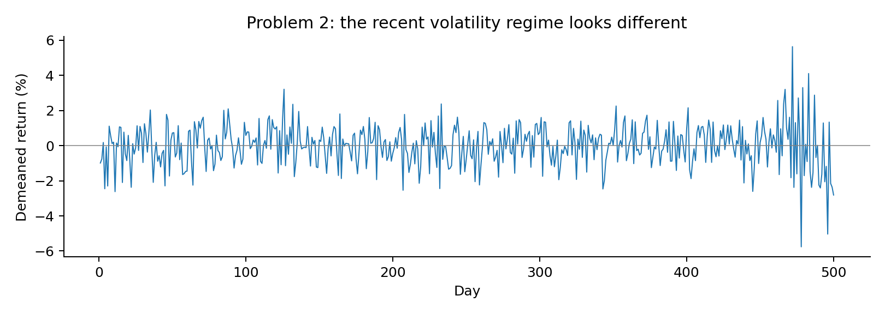
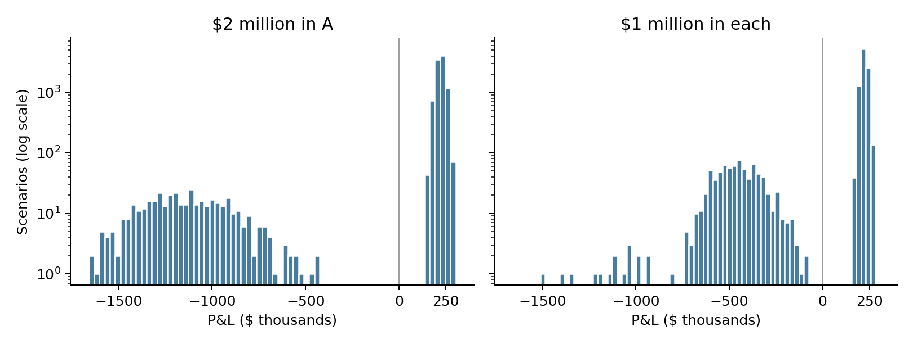
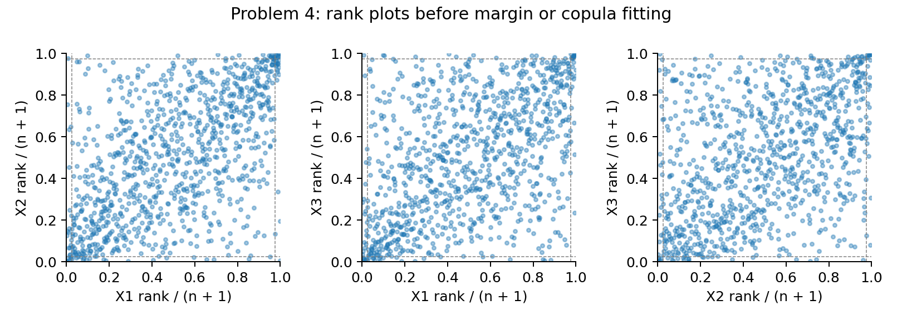

# Assignment 2 - Problem 1: Mismatched Histories

All risks below use the course's loss-positive convention. Moments mean (mean,
sample variance, skewness, excess kurtosis). Predictions were recorded before fitting.

## Predict (a)-(c)

Jointly observed days are shown below; only 81 days contain all five returns.
Correlations involving D should be least reliable because they use only 83-96 days.

```text
       A    B    C    D  IDX
A    242  242  221   93  242
B    242  242  221   93  242
C    221  221  228   83  228
D     93   93   83   96   96
IDX  242  242  228   96  250
```

Complete-case correlation is PSD: all columns use the same standardized data
matrix, so its correlation is a Gram matrix. Pairwise correlation can fail PSD
because its entries use different days and different means/scales. Since IDX is
almost a weighted copy of the stocks, the true smallest eigenvalue should be
near zero. That makes even small pairwise inconsistencies dangerous here.

## Fit (d)-(f)

Correlation matrices, in A, B, C, D, IDX order:

```text
Complete case:
1.00000  0.39673  0.24662  0.41355  0.87136
0.39673  1.00000  0.31689  0.23605  0.67086
0.24662  0.31689  1.00000  0.18518  0.56484
0.41355  0.23605  0.18518  1.00000  0.57193
0.87136  0.67086  0.56484  0.57193  1.00000
Pairwise:
1.00000  0.46863  0.43089  0.43845  0.86958
0.46863  1.00000  0.46302  0.27669  0.73287
0.43089  0.46302  1.00000  0.18461  0.71357
0.43845  0.27669  0.18461  1.00000  0.60569
0.86958  0.73287  0.71357  0.60569  1.00000
```

Complete eigenvalues: 0.001506, 0.548345, 0.693320, 0.870441, 2.886388;
Cholesky succeeds. Pairwise: -0.011072, 0.471422, 0.528367, 0.857381, 3.153902;
Cholesky fails. Full-history SDs are 0.016502, 0.011919, 0.018324, 0.022829,
0.012281. With covariance = correlation times the outer product of these SDs and
weights (-0.4, -0.3, -0.2, -0.1, 1), tracking variance is **-1.799370e-6**.

Rebonato-Jackel: minimum eigenvalue approximately 0; Frobenius change 0.016182;
tracking variance 6.807298e-7. Higham: minimum eigenvalue -4.25e-13 (numerical
zero); change 0.015520; tracking variance 6.787649e-7.

## Reconcile (g)-(i)

PSD requires w'Cov w >= 0 for every w. Negative tracking variance is impossible,
so the pairwise estimates cannot describe one joint return distribution.
Higham's largest changes are A/IDX -0.007045, C/IDX -0.004765, B/IDX -0.004180,
and D/IDX -0.003727. These are not simply the least-observed D pairs. Higham uses
the offending eigenvector and the global PSD/unit-diagonal constraints, not
sample counts. The complete/pairwise gap is 0.423935, versus repairs around
0.016 and a 0.004579 gap between repairs. Thus estimator choice matters much more.

\newpage

# Assignment 2 - Problem 2: A Changed Volatility Regime

## Predict (a)-(c)

The plot suggests the last roughly 40 days differ from the first 460. Before
fitting, my ranking was historical < t < equally weighted normal < EW 0.97 <
EW 0.94. Recent weighting should increase risk after a volatility rise; 0.94
should react fastest. The first three were uncertain because they mix regimes.

For 0.94: effective sample size 32.33, half-life 11.20 days, weight on the last
40 days 91.58%. For 0.97: 65.67, 22.76 days, 70.43%. Finite weights are normalized;
effective sample size = 1/sum(weight squared).

Removed mean: 0.000161876. Demeaned moments: (0, 0.000141898, -0.155587,
2.132367). A normal population has zero skewness and zero excess kurtosis.
Sample moments need not be zero, but this kurtosis and the time pattern make a
single constant-volatility normal regime implausible.



## Fit (d)

One-day 5% VaR on $1,000,000: equally weighted normal **$19,594**; EW 0.97
**$34,064**; EW 0.94 **$36,308**; fitted t **$18,872**; historical **$20,574**.
The normal models have zero expected return. EW SD uses the weighted mean, as
in Week 3. The t MLE gives location 0.000181639, scale 0.010289990, and
nu 8.269918. Scale is not the t standard deviation.

## Reconcile (e)-(g)

The actual order is t < equally weighted normal < historical < EW 0.97 < EW 0.94.
I placed historical too low. Its observed 5% tail includes volatile-period losses;
the t fit gives more influence to the quieter bulk and has a smaller fitted scale.
Heavy tails do not automatically make the t's 5% VaR larger than a normal VaR.

The earlier-regime SD is 1.0178%, versus 2.4289% for the last 40 days. Mixing
different normal variances can create excess kurtosis: a zero-mean two-normal
mixture using these SDs and sample proportions has excess kurtosis about 2.57.
This supports a regime-mixture explanation, not proof of normality in each regime.
The fitted t describes the pooled mixture, not today's conditional volatility.

EW SDs are 2.0709% (0.97) and 2.2074% (0.94). Using SD/sqrt(2*n_eff), their
rough SD errors are 0.1807% and 0.2745%, or VaR errors of $2,972 and $4,515.
The $2,244 VaR gap is smaller than either estimate's rough error. These estimates
share observations, so this is a scale comparison, not a formal difference test.
**Opinion:** use 0.94 for a responsive trading limit and 0.97 for a steadier capital
baseline, with a separate stress/current-regime check so stability does not hide risk.

\newpage

# Assignment 2 - Problem 3: Diversification and VaR

## Predict (a)-(b)

Bond moments: A (0.083709, 0.018493, -4.822523, 22.081997); B (0.085011,
0.017451, -4.914778, 23.074367). Large negative skewness and excess kurtosis,
plus separate gain/default clusters in the plot, make one normal model unsuitable.

Losses worse than 20% occur in 406 A scenarios, 393 B scenarios, and 782 scenarios
for at least one bond; both lose that much in 17. Individual frequencies are below
5%, but their union is 7.82%. I predict diversification raises 5% VaR by moving
its quantile into the default cluster, but lowers ES versus $2 million in A:
most defaults then affect only half the investment.



## Fit (c)-(e)

All numbers are dollars. Historical 5% (VaR, ES):

- $1 million A: (-84,531, 443,628).
- $1 million B: (-86,011, 419,587).
- $2 million A: (-169,061, 887,257).
- $1 million each: (414,767, 541,997).

Normal 5% VaRs, in the same order: 139,971; 132,277; 279,941; 143,466.
These use each P&L's actual mean and sample SD, not a zero-mean assumption.

Historical 1% (VaR, ES), in the same order: (650,545, 709,548);
(641,248, 700,805); (1,301,090, 1,419,096); (598,237, 716,408).

## Reconcile (f)-(h)

Both predictions hold. At 5%, combined VaR $414,767 exceeds the sum of individual
VaRs, -$170,542: VaR fails subadditivity. Combined ES $541,997 is below the sum
$863,216: ES passes. Negative VaR means even the cutoff scenario has a gain;
it does not mean defaults are absent. ES includes those defaults in its tail average.

Normal VaR favors the diversified investment ($143,466 versus $279,941), because
its volatility is lower. That correctly describes variance reduction, but it gives
the wrong 5% VaR ordering: the normal smooths away the jump between gains and defaults.

At 1%, both quantiles lie inside the default-loss region. Concentrated VaR becomes
$1,301,090 versus diversified $598,237; most diversified losses still affect just
one bond. The combined 1% VaR is also below the sum of individual 1% VaRs.
Thus VaR's failure depends on where the chosen quantile lies, not on a rule that
diversification always raises VaR. ES falls under diversification at both levels.

\newpage

# Assignment 2 - Problem 4: Gaussian or t Copula

## Predict (a)-(b)

Moments: X1 (0.000257, 0.000141470, -0.034174, -0.122542); X2 (-0.000252,
0.000261420, -0.614117, 7.083388); X3 (0.000890, 0.000100377, 0.073955, 2.853745).
I predict normal for X1 and t for X2/X3. Removing X2's most extreme observation
(row 952, -14.2914%) lowers its excess kurtosis to 1.710093 and skewness to
0.055783. It strongly influences the moments; I retain it in every actual fit.

Rank/(n+1) plots and joint lower/upper 2.5% counts suggest shared extremes:
X1/X2 6/8, X1/X3 7/12, X2/X3 6/9. Independence predicts only 0.625 days per pair.
The joint corners look more clustered than the middle, suggesting stronger tail
association. I predict t, while recognizing that ordinary positive correlation
also raises these counts; the counts alone do not prove tail dependence.



## Fit (c)-(f)

Margin AICc (normal, t): X1 (-6022.54, -6020.52), choose normal;
X2 (-5408.49, -5518.18), choose t; X3 (-6365.69, -6428.02), choose t.
Chosen parameters (location, scale, nu): X1 (0.000257, 0.011888, not applicable);
X2 (-0.000176, 0.012544, 5.271506); X3 (0.000746, 0.008181, 6.094916).

Fitted-CDF uniforms give Kendall-based R correlations 0.583263 (X1/X2),
0.502851 (X1/X3), 0.464383 (X2/X3). Gaussian: log likelihood 350.440286,
nu infinite, AICc/BIC -700.880573. t: log likelihood 451.999415, nu 3.659932,
AICc -901.994821, BIC -897.091074. Following Week 5, common R and margins
are fixed; free-parameter counts are 0 and 1.

From 100,000 simulated days (seed 1234), dollars in order (VaR5, ES5, VaR1, ES1):
Gaussian (49,643, 66,542, 76,774, 94,425); t (49,211, 67,938, 78,863, 99,425);
historical (47,939, 65,699, 70,092, 102,424).

Expected lower/upper joint-tail days per 1,000, pair order X1/X2, X1/X3, X2/X3:
Gaussian 5.94/5.95, 5.01/4.34, 4.43/4.25; t 9.31/9.01, 8.11/7.74, 7.49/7.46.
The simulations use population copula cutoffs 0.025/0.975.

## Reconcile (g)-(j)

t wins by 201.114 AICc and 196.211 BIC points, agreeing with the prediction.
Its joint-tail counts are generally closer, especially for upper tails, but not
every cell. Counts are small/noisy; neither symmetric copula fits the observed
upper/lower asymmetry exactly. ES1 moves most, about $5,000, because it averages
the most extreme joint losses. VaR5 barely moves (-$432): the shared margins and
R keep the moderate tail similar; copula tail dependence matters more farther out.

The total daily likelihood gain is 101.559. The 784 days with all observed ranks
inside 5%-95% contribute 49.800, or 49.04%; the other days contribute 51.759.
Thus nearly half the gain is from non-extreme days: information criteria score
the whole distribution, not just extreme-loss performance. Daily contributions
are saved in results/problem4_daily_likelihood.csv. For the most correlated pair
X1/X2, t tail dependence = 2*tCDF(-sqrt((nu+1)*(1-rho)/(1+rho)), nu+1) = 0.321942;
Gaussian tail dependence is zero.

\newpage

# Assignment 2 - Problem 5: Residual Correlation

## Predict (a)

With residual covariance c > 0, its variance contribution is +2*(1 million)^2*c
for P1 and -2*(1 million)^2*c for P2. Setting c to zero should therefore
understate long-long P1 VaR and overstate long-short P2 VaR. This prediction
assumes positive shared-industry residual covariance.

## Fit (b)-(d)

There are 500 arithmetic returns. OLS results:

- A: alpha 0.000205013; beta 1.035278; residual SD 0.012888300.
- B: alpha 0.000314773; beta 0.935417; residual SD 0.011538442.
- Residual correlation: 0.698307; residual covariance: 0.000103846.

Sample variances/covariances use n-1 throughout, including the residual SDs.
The regressions include an intercept, but simulation omits fitted alphas and
uses a zero-mean market and errors to respect the required zero expected returns.

One-day 5% VaR in dollars, from 100,000 simulations with seed 1234:

- Full residual covariance: P1 **50,715**; P2 **15,823**.
- Independent residuals: P1 **44,732**; P2 **28,430**.
- Direct delta normal, using stock sample covariance: P1 **50,415**; P2 **15,834**.

The same standard-normal draws are reused in both simulations, so the changed
assumption, rather than a different random sample, drives their difference.

## Reconcile (e)-(f)

Residual covariance is positive, and both directions match the prediction.
P2 is more exposed in percentage terms: ignoring residual correlation changes
analytic VaR by +80.04%, versus -11.74% for P1. P2's market exposure is only
beta_A - beta_B = 0.099861; its offsetting stock positions also cancel much of
the shared residual risk. Assuming independent errors removes that cancellation.

OLS residuals are orthogonal to the market in this sample. Therefore
Cov(stocks) = beta*beta'*Var(market) + Cov(residuals), with maximum reconstruction
error 1.63e-19. Under joint normality, zero covariance also implies independence
between the market and residual vector. The full market model and direct
joint-normal stock model consequently give exactly the same population
distribution and analytic VaR. The small simulated differences are Monte Carlo noise.

This agreement needs linear P&L, matching covariance/mean conventions, and the
normal-distribution assumptions. Non-normal factor/errors or nonlinear holdings
can change simulated tail quantiles even with the same covariance. Changing the
estimation window, residual variance denominator, or future conditional volatility
also breaks the matching setup. OLS orthogonality alone does not establish
independence for non-normal data.

## Conventions and reproducibility

See README.md for commands. Historical VaR uses the Week 4 floor/ceiling order
statistics (1-based); ES averages observations at or below that return/P&L
cutoff. All required tail sizes here are integers and the inputs have no cutoff
ties. Negative VaR is kept, not replaced by zero. Figures and unrounded JSON
results accompany this PDF. Results use only the five supplied input CSV files.
