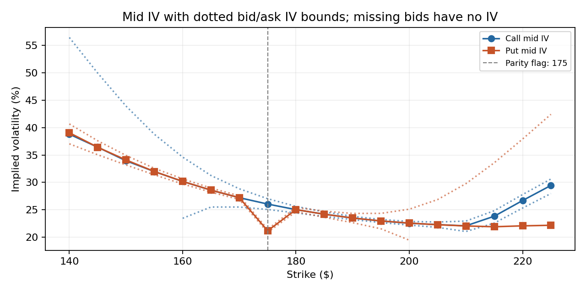
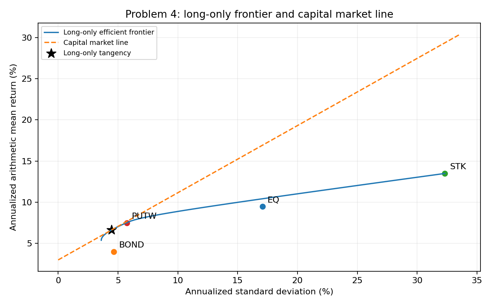
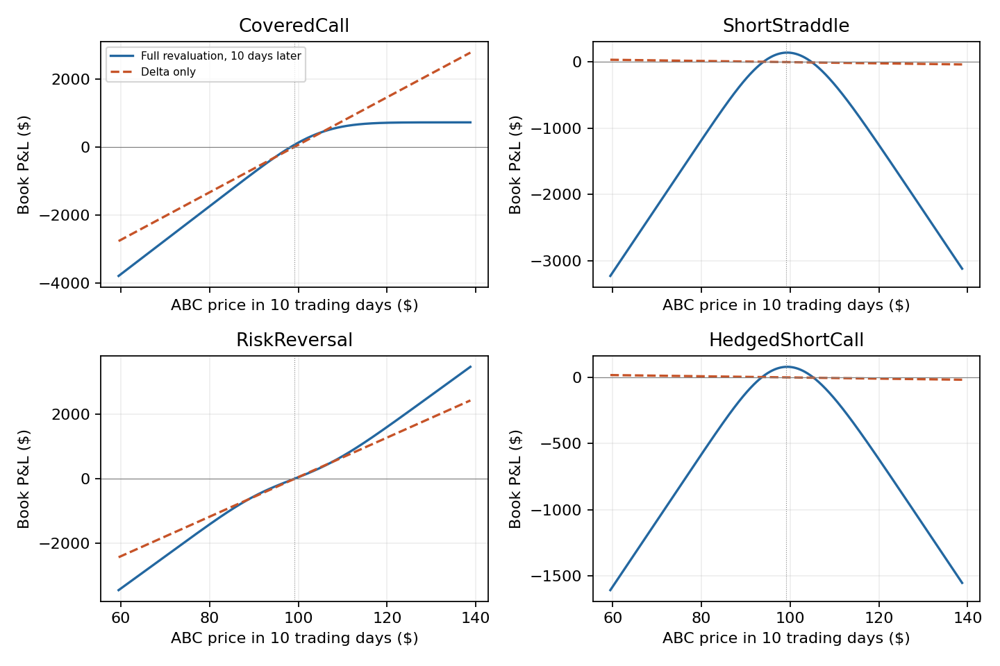
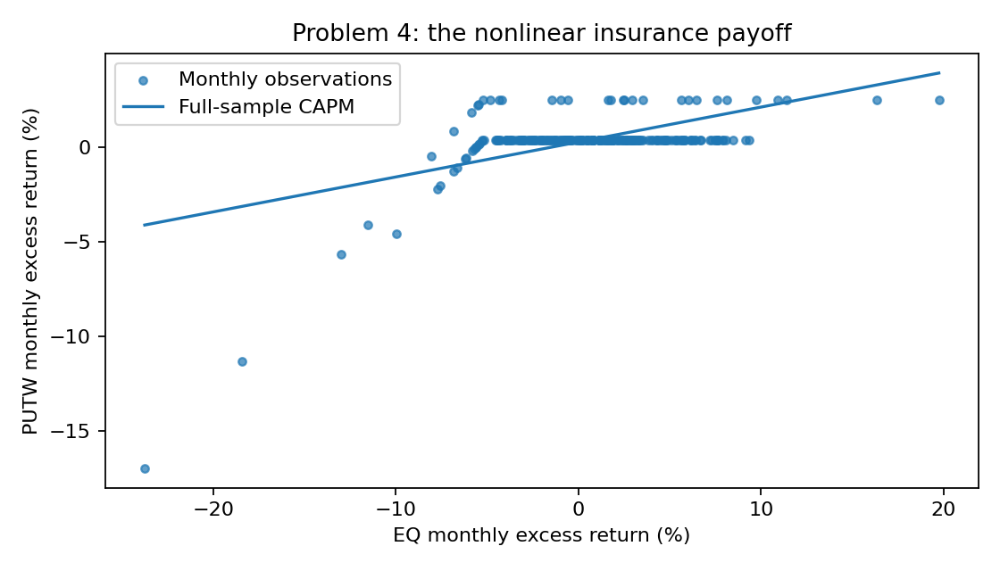

# Assignment 3 Responses

## Problem 1 - Implied volatility from a dirty chain

**Predict (a-c).** I expected low-vega wings to have unstable IVs, and the three identical $0.05/$0.10 call quotes above 210 to create an artificial upturn. Before inversion, parity flags strike 175. A stale or mismatched quote is more plausible than a genuine volatility difference; parity alone does not tell us which leg is wrong.

Using T = 35/365 and carry r-q, gap = Cmid - Pmid - S exp(-qT) + K exp(-rT). Each entry below is strike: signed gap/full combined spread, in dollars. 140: -0.0045/1.40; 145: +0.0002/1.25; 150: -0.0051/1.10; 155: -0.0005/0.95; 160: -0.0008/0.83; 165: -0.0012/0.69; 170: -0.0015/0.59; 175: +0.8882/0.47; 180: -0.0022/0.43; 185: +0.0025/0.44; 190: +0.0022/0.46; 195: -0.0032/0.53; 200: -0.0035/0.65; 205: +0.0012/0.78; 210: +0.0008/0.92; 215: +0.0355/1.05; 220: +0.0602/1.20; 225: +0.0698/1.36. Only |gap| > band is flagged; this is the assignment's deliberately conservative spread test.

Exact parity implies equal call/put IV: the GBSM call-minus-put price is independent of volatility, and each price increases with volatility. Passing a spread band is weaker than exact parity, so small IV differences at unflagged strikes are possible.

**Fit (d-e).** Appendix A reports every bid/mid/ask IV, each mid-price vega, and the local IV change for a $0.01 price increase. Appendix C plots both smiles and bid/ask IVs. IV is obtained by root-finding on our own GBSM; no option-pricing package is used.

Nine bids are below their discounted-intrinsic lower bound: calls at 140, 145, 150, 155 and puts at 205, 210, 215, 220, 225. No nonnegative-volatility price can match these bids. All mids and asks have a finite IV. Vega is dollars per 1.00 change in volatility; one-cent IV movement in percentage points is 100 x 0.01/vega.

**Reconcile (f).** Strike 175 appears as a put-IV dip: call IV 26.0457%, put IV 21.1620%. Using average call/put vega 18.1213, its $0.8882 parity gap predicts 4.9013 vol points; the actual gap is 4.8837. The linear vega calculation explains the discrepancy closely, not exactly, because vega changes with IV.

**Reconcile (g-h).** Above 210, constant call mids of $0.075 imply rising IVs of 23.8225%, 26.6888%, 29.4473%. A cent moves IV by about 0.443, 0.482, 0.519 points, and each bid/ask IV interval spans roughly 2.3-2.7 points. The puts have even lower vega and very wide IV ranges. This is weak price information, not convincing evidence of a market upturn. Parity misses it because dollar errors of $0.0355-$0.0698 lie inside $1.05-$1.36 combined spreads. Excluding strike 175 and the contaminated call wing, IV falls from about 39% at 140 toward 22% near 210: downside protection is priced at higher volatility than upside exposure. This is consistent with stronger downside demand, not proof of its cause.

## Problem 2 - American options and discrete dividends

**Predict (a-b).** The exercise hurdles are $0.891948 and $0.224495. Dividend 1 ($0.25) fails; dividend 2 ($1.50) passes. I expected call exercise to be possible just before dividend 2 at sufficiently high stock prices. I predicted lower European/American call values, higher put values, a larger call exercise premium and a smaller put exercise premium: waiting for the stock drop benefits the put holder.

**Fit (c).** Without dividends, GBSM European call/put = $3.922268/$4.309830; N=300 American tree call/put = $3.923772/$4.439703. With dividends, European tree call/put = $3.176722/$5.286403; American tree call/put = $3.469960/$5.372075.

Subtracting PV(dividends) = $1.722119 from spot gives approximate GBSM European call/put $3.072293/$5.181974, each $0.104429 below the exact-dividend tree. PV subtraction changes the initial diffusion base; fixed cash jumps cannot generally be replaced by a smaller lognormal stock.

**Fit (d).** American call/put convergence: N=25: 3.4723/5.3962; N=50: 3.4715/5.3680; N=75: 3.4687/5.3716; N=100: 3.4726/5.3793; N=105: 3.4651/5.3682; N=150: 3.4683/5.3693; N=200: 3.4675/5.3711; N=250: 3.4712/5.3734; N=300: 3.4700/5.3721. The oscillation, including 100 versus 105, is normal lattice error. N=300 is the reported estimate, not an exact continuous-time price.

**Fit (e).** Central delta/gamma at fixed N=100, with stock bumps in dollars: call h=1: 0.502907/0.032969; h=0.1: 0.494449/0.000000; h=0.01: 0.494449/-0.000000; h=0.001: 0.494449/-0.000000. put h=1: -0.546951/0.014408; h=0.1: -0.542199/0.006421; h=0.01: -0.542239/0.006159; h=0.001: -0.542243/0.009729. Tiny values printed as zero are numerical near-zero values.

**Fit (f).** N=300 sensitivities per dollar of dividend 1/dividend 2, using central $0.01 bumps: european call: -0.450523, -0.395406; american call: -0.490946, -0.111976; european put: 0.544987, 0.586755; american put: 0.555088, 0.597279.

**Reconcile (g).** Matched-tree American-minus-European premiums without/with dividends: call $0.000000/$0.293238; put $0.128369/$0.085672. Both predictions held. Without dividends, American-minus-GBSM is $0.001504 for the call and $0.129873 for the put; the call difference is discretization, not exercise value. Just before dividend 2, exercise becomes optimal above about $52.7008 (N=100: $52.7756; continuous post-dividend GBSM check: $52.7168).

**Reconcile (h-i).** Gamma is unreliable as the bump shrinks: a fixed-grid tree is piecewise linear in spot, with kinks where exercise or terminal payoffs switch. A tiny bump can miss every kink and return zero, or cross one and give an unstable number. This is not just floating-point error. The American call can exercise before dividend 2, largely avoiding that cash drop; its sensitivity to dividend 2 is therefore much smaller than to dividend 1, before which exercising is not worthwhile. The European call has no such escape.

## Problem 3 - VaR of an option book

**Predict (a-b).** At S=$99.12, book delta/gamma/theta (theta per year) are: CoveredCall: 69.9161, -3.7925, 1477.7764; ShortStraddle: -0.8888, -8.0921, 3313.3549; RiskReversal: 61.3887, 0.5360, 18.5884; HedgedShortCall: -0.4444, -4.0461, 1868.1176. I ranked dollar delta-normal error: ShortStraddle, HedgedShortCall, CoveredCall, RiskReversal. Negative gamma suggests understatement for the first three; small positive local RiskReversal gamma suggests slight overstatement. Positive theta predicts positive no-move P&L in all four. The two nearly delta-neutral short-gamma books should have especially high ES/VaR ratios.

**Fit (c).** The 500 daily arithmetic returns have mean 0.00032140, sample variance 0.00027803, skew 0.01906, excess kurtosis 2.42739. Normal MLE: mean 0.00032140, SD 0.01665760, AICc -2671.926. Student t MLE: df 5.78918, location 0.00000118, scale 0.01350619 (SD 0.01669432), AICc -2700.349. The t wins; AICc counts 2/3 parameters.

**Fit (d-f).** Dollar VaR/ES pairs below are ordered 5%, then 1%. DN uses sample daily SD, zero mean and sqrt(10). Normal (N) and t use their fitted scale/shape with daily mean set to zero, 1,000,000 paths, seed 1234, ten compounded daily returns, fixed IV and 20/255 years remaining. Appendix D plots full P&L against terminal stock with the delta-only line.

**CoveredCall.** Current value $9744.78. DN 601.05/753.74; 850.08/973.91. N mean $6.22, risk 679.35/872.31; 995.79/1147.27. t mean $6.65, risk 678.33/893.57; 1024.45/1218.27.

**ShortStraddle.** Current value $-788.44. DN 7.64/9.58; 10.81/12.38. N mean $19.68, risk 315.10/484.48; 587.31/745.94. t mean $20.49, risk 321.65/518.37; 633.36/844.46.

**RiskReversal.** Current value $-65.79. DN 527.75/661.81; 746.40/855.12. N mean $8.50, risk 491.04/639.97; 734.32/863.46. t mean $8.48, risk 490.30/658.18; 757.82/926.85.

**HedgedShortCall.** Current value $4580.84. DN 3.82/4.79; 5.40/6.19. N mean $18.14, risk 149.25/233.94; 285.35/364.67. t mean $18.54, risk 152.52/250.88; 308.38/413.93.

**Reconcile (g).** Small delta does not remove gamma or theta: dP approximately equals delta*dS + 0.5*gamma*dS^2 + theta*dt. Under t, ShortStraddle/HedgedShortCall 5% delta-gamma (no theta) VaRs are $429.74/$214.87; adding theta gives $299.80/$141.61, versus full $321.65/$152.52. At 1%, delta-gamma-theta VaRs are $663.60/$323.51 and ES $967.61/$475.52, versus full $633.36/$308.38 and $844.46/$413.93. Curvature helps, but frozen Greeks cannot reproduce changing gamma and expiry. Exact no-move P&L: CoveredCall $60.55; ShortStraddle $143.06; RiskReversal $3.73; HedgedShortCall $79.83.

**Reconcile (h-i).** Means are positive as predicted: short-gamma carry compensates large-move losses, not free profit. The error ranking holds for 5% VaR; RiskReversal can understate deep t-tail risk because its short put dominates after a large fall. Normal-to-t changes 5% VaR little, but raises 1% ES by about $99 for the straddle and $49 for the hedge. Similar fitted SDs and ten-day averaging keep moderate quantiles close; ES still sees rare jumps. Their t 5% ES/VaR ratios are 1.61/1.64; the zero-mean normal reference is 1.25 at 5%, not at every tail level.

**Reply (j).** The book is nearly delta-flat, not risk-flat: its actual delta is -0.4444 and its negative gamma leaves losses after a large move in either direction. At ten days, the t-model 1% VaR/ES are about $308/$414, so limits should include full-revaluation tail risk rather than delta alone.

## Problem 4 - A Sharpe ratio that sells insurance

**Predict (a-b).** Each asset below lists monthly mean, variance in decimal-return squared, skew, excess kurtosis, annual Sharpe, and mean SE in percentage points. These are sample variance and central standardized moments; RF=3%/12 per month. I expected over 50% PUTW in the long-only optimum and historical 1% ES well above a normal approximation.

EQ: 0.790%, 0.0024272, -0.3849, 3.4212, 0.3798, SE 0.3180 points.

BOND: 0.333%, 0.0001812, 0.0867, 0.4816, 0.2128, SE 0.0869 points.

STK: 1.124%, 0.0086986, -0.0606, 0.7703, 0.3248, SE 0.6020 points.

PUTW: 0.624%, 0.0002739, -6.5254, 59.8505, 0.7834, SE 0.1068 points.

PUTW's 2008-06-30 loss of 16.720% supplies 45.95% of centered squared deviations and 80.61% of fourth powers. Removing it only as an influence check changes excess kurtosis to 39.87 and Sharpe to 1.272. All months remain in the actual optimization.

**Fit (c-d).** Weights are percentages in EQ/BOND/STK/PUTW order. Risk numbers are monthly percentage-loss VaR/ES pairs at 5%, then 1%; H means historical and N same-mean/sample-SD normal. The frontier, CML and four assets appear in Appendix C.

unconstrained: weights -4.387, 24.650, 2.269, 77.468; annual Sharpe 0.8198. H 0.374/2.898; 5.908/10.335. N 1.574/2.115; 2.456/2.895.

long only: weights 0.000, 26.068, 0.919, 73.013; annual Sharpe 0.8153. H 0.290/2.926; 5.999/10.265. N 1.564/2.102; 2.441/2.877.

putw capped 20pct: weights 14.625, 63.621, 1.754, 20.000; annual Sharpe 0.5902. H 1.559/2.837; 3.934/5.973. N 1.670/2.214; 2.557/2.998.

**Fit (e).** PUTW excess-return CAPM: monthly alpha 0.2745%, alpha t 3.0516, beta 0.1848, R-squared 0.3026. Regressing separately in 26 months with EQ excess return below -5% gives beta 0.9428.

**Reconcile (f-g).** Both predictions held. The optimizer bought premium income from selling crash insurance. Sharpe sees only mean and SD; it does not distinguish occasional catastrophic losses from symmetric noise. ES averages tail severity. Population/exact empirical ES is monotone, cash-translation invariant, positively homogeneous and subadditive, so diversification does not increase aggregate risk beyond the sum of stand-alone ES. Positive linear CAPM alpha is not proof of skill: full-sample beta about 0.18 hides downside beta about 0.94 and a nonlinear put payoff.

**Reconcile (h).** The mean SEs above are SD/sqrt(240), assuming independent months. They are large relative to the excess means, so precise tangency weights are not trustworthy. A six-month-block bootstrap (500 samples) gives long-only PUTW weights from 19.00% to 100.00% at the 2.5/97.5 percentiles. The 20% cap controls concentration; its stability is imposed, not statistical precision. Two unrestricted bootstrap samples have no finite positive tangency and are excluded, with counts retained in the results.

At 1%, the course historical ES uses the two worst months. Fractional empirical ES uses 2.4 months and gives long-only 9.205%, still far above normal 2.877%. This distinction matters with only 240 months; it does not change the insurance-risk conclusion. Dates through 2026-11-30 are supplied exercise data, not a claim of already observed live performance.

## Problem 5 - Alpha or factor exposure?

**Predict (a-b).** The funds cover 1996-10-01 to 2001-09-28, with 1,257 matched dates. Factors and RF are converted from percent to decimal. Initial CAPM made FUND1 look more skilled, but its large residual correlation with momentum suggested that adding momentum would remove much of its alpha. FUND2 should change less.

FUND1: daily mean excess 0.06236%, total-return SD 1.17454%, annual Sharpe 0.8479. CAPM daily alpha 0.00044066, t 3.2043. Residual correlations with SMB/HML/Mom: -0.06117, 0.20520, 0.80146. Sharpe uses excess-return SD; annualization uses 255 trading days.

FUND2: daily mean excess 0.03376%, total-return SD 0.71860%, annual Sharpe 0.7500. CAPM daily alpha 0.00024491, t 1.8349. Residual correlations with SMB/HML/Mom: 0.32953, -0.12063, 0.05302. Sharpe uses excess-return SD; annualization uses 255 trading days.

**Fit (c).** Appendix B lists every coefficient and SE, alpha t, R-squared and AICc for all six regressions. SEs are conventional homoskedastic OLS. Gaussian AICc includes residual variance: 3 parameters for CAPM, 5 for FF3 and 6 for Carhart. Alpha is a daily decimal return; betas are unitless.

**Fit (d).** The most recent decade in the factor files is (2014-09-30, 2024-09-30], containing 2,516 dates. Daily mean Mkt-RF/SMB/HML/Mom/RF = 0.00048998, -0.00004662, -0.00009384, 0.00009658, 0.00006169. Annual total expectation is 255 x (mean RF + betas x mean factors), adding 255 x fitted alpha only in the with-alpha case.

FUND1: expected annual without/with alpha 13.705%/13.780%; realized annual arithmetic return 20.900%. These later factor premia are a hypothetical repricing of older exposures, not an out-of-sample historical forecast.

FUND2: expected annual without/with alpha 6.892%/13.848%; realized annual arithmetic return 13.605%. These later factor premia are a hypothetical repricing of older exposures, not an out-of-sample historical forecast.

**Fit (e).** The entire momentum file's worst day is 1939-09-05, return -18.44%. With other factors flat, the isolated shock is momentum beta times that return; alpha, RF and residual shocks are not added.

FUND1: momentum beta 0.393551; $10 million loss $725,708.51, equal to 6.1787 sample daily standard deviations.

FUND2: momentum beta 0.005834; $10 million loss $10,758.42, equal to 0.1497 sample daily standard deviations.

**Reconcile (f).** The predictions held. FUND1 CAPM/FF3/Carhart daily alphas are 0.00044066, 0.00029631, 0.00000294; FUND2 alphas are 0.00024491, 0.00027715, 0.00027280.

Sample daily market/SMB/HML/Mom premia are 0.00021607, -0.00016277, 0.00037168, 0.00078186. FUND1's CAPM-minus-Carhart alpha = 4.377216 daily basis points, decomposed into market-beta change/SMB/HML/Mom = 0.220975, -0.001359, 1.080573, 3.077026. The omitted momentum and value exposures explain almost all the apparent alpha.

**Reconcile (g-h).** Under APT, alpha is unexplained expected excess return relative to the chosen factors, not an absolute certificate of skill. Opinion: FUND2 is the more defensible alpha-fee candidate, but its four-factor t around 2.15 is modest evidence, not proof of persistence. I would use Carhart to screen omitted momentum; FF3 has slightly better AICc for FUND2 because momentum adds little. FUND1's high sample return relied on factor premia that do not carry over to the later decade. Factor models clarify exposures, but optimizer inputs still depend on noisy premia and stable betas/alpha; do not mechanically extrapolate historical returns.

## Appendix A - Every option IV and sensitivity

For each strike: call and put bid/mid/ask IVs (%); vega (dollars per 1.00 volatility); one-cent IV movement (volatility percentage points). NA means the bid is below the no-arbitrage lower bound. All displayed results are rounded; CSV and JSON retain full precision.

**K=140.** Call IV NA/38.7995/56.4704; vega 1.6318; cent 0.6128 | Put IV 37.0438/39.0690/40.6789; vega 1.6886; cent 0.5922.

**K=145.** Call IV NA/36.4327/49.9741; vega 2.3732; cent 0.4214 | Put IV 35.0507/36.4246/37.6071; vega 2.3710; cent 0.4218.

**K=150.** Call IV NA/33.9509/43.9470; vega 3.3902; cent 0.2950 | Put IV 33.1872/34.1015/34.9362; vega 3.4441; cent 0.2904.

**K=155.** Call IV NA/31.9831/38.7985; vega 5.0566; cent 0.1978 | Put IV 31.3835/31.9926/32.5707; vega 5.0609; cent 0.1976.

**K=160.** Call IV 23.4412/30.1733/34.6215; vega 7.4599; cent 0.1340 | Put IV 29.7076/30.1843/30.6458; vega 7.4655; cent 0.1339.

**K=165.** Call IV 25.5023/28.5822/31.2575; vega 10.7449; cent 0.0931 | Put IV 28.2175/28.5929/28.9618; vega 10.7504; cent 0.0930.

**K=170.** Call IV 25.5019/27.2050/28.8295; vega 14.7579; cent 0.0678 | Put IV 26.8747/27.2151/27.5522; vega 14.7621; cent 0.0677.

**K=175.** Call IV 25.0578/26.0457/27.0221; vega 18.8417; cent 0.0531 | Put IV 20.8738/21.1620/21.4485; vega 17.4008; cent 0.0575.

**K=180.** Call IV 24.4240/25.0206/25.6166; vega 21.8006; cent 0.0459 | Put IV 24.6405/25.0305/25.4203; vega 21.8009; cent 0.0459.

**K=185.** Call IV 23.7678/24.1920/24.6161; vega 22.3970; cent 0.0446 | Put IV 23.6226/24.1808/24.7388; vega 22.3968; cent 0.0446.

**K=190.** Call IV 23.2052/23.5042/23.8021; vega 20.1044; cent 0.0497 | Put IV 22.6435/23.4934/24.3352; vega 20.1020; cent 0.0497.

**K=195.** Call IV 22.6570/22.9465/23.2332; vega 15.6218; cent 0.0640 | Put IV 21.5218/22.9668/24.3429; vega 15.6327; cent 0.0640.

**K=200.** Call IV 22.1983/22.5355/22.8649; vega 10.5050; cent 0.0952 | Put IV 19.4455/22.5688/25.1057; vega 10.5300; cent 0.0950.

**K=205.** Call IV 21.7856/22.2856/22.7570; vega 6.1876; cent 0.1616 | Put IV NA/22.2667/26.8623; vega 6.1734; cent 0.1620.

**K=210.** Call IV 21.0309/22.0671/22.9367; vega 3.1927; cent 0.3132 | Put IV NA/22.0410/29.7769; vega 3.1774; cent 0.3147.

**K=215.** Call IV 22.5619/23.8225/24.8267; vega 2.2580; cent 0.4429 | Put IV NA/21.9007/33.5862; vega 1.4603; cent 0.6848.

**K=220.** Call IV 25.3138/26.6888/27.7811; vega 2.0733; cent 0.4823 | Put IV NA/22.0618/37.9250; vega 0.6582; cent 1.5193.

**K=225.** Call IV 27.9646/29.4473/30.6226; vega 1.9250; cent 0.5195 | Put IV NA/22.1676/42.4353; vega 0.2716; cent 3.6815.

Numerical conventions: sample variance uses n-1; skewness/excess kurtosis are standardized central moments. Historical VaR uses the average floor/ceiling order statistics at alpha*n (1-based); ES is minus the mean below that cutoff. Negative values would mean gains, not values to convert with abs().

Problem 3 simulation uncertainty: results are estimates. With ten independent simulation batches, t-model 1% ES Monte Carlo SE is about $3.83 for ShortStraddle and $1.92 for HedgedShortCall. Arithmetic normal/t models have unbounded downside; no <=-100% return occurred in these seeded draws, and none was clipped or retried. This tail-support limitation remains a model assumption.

## Appendix B - Complete regression estimates

Each coefficient is estimate (standard error). Alpha is daily decimal return; all other coefficients are unitless. The intercept is included in every regression.

**FUND1, CAPM.** alpha 0.00044066 (0.00013752); Mkt-RF 0.84688969 (0.01090001). Alpha t 3.20433; R-squared 0.827887; AICc -9812.41771.

**FUND1, FF3.** alpha 0.00029631 (0.00013109); Mkt-RF 1.00172712 (0.01716202); SMB 0.08278215 (0.02049981); HML 0.33461403 (0.02881209). Alpha t 2.26035; R-squared 0.845206; AICc -9941.70192.

**FUND1, Carhart4.** alpha 0.00000294 (0.00006985); Mkt-RF 0.94915974 (0.00916635); SMB 0.00083472 (0.01098875); HML 0.29072787 (0.01532883); Mom 0.39355125 (0.00697218). Alpha t 0.04206; R-squared 0.956333; AICc -11530.40794.

**FUND2, CAPM.** alpha 0.00024491 (0.00013347); Mkt-RF 0.42877047 (0.01057928). Alpha t 1.83487; R-squared 0.566886; AICc -9887.50085.

**FUND2, FF3.** alpha 0.00027715 (0.00012652); Mkt-RF 0.44430281 (0.01656351); SMB 0.21001044 (0.01978489); HML -0.00380013 (0.02780729). Alpha t 2.19057; R-squared 0.614831; AICc -10030.94129.

**FUND2, Carhart4.** alpha 0.00027280 (0.00012691); Mkt-RF 0.44352351 (0.01665490); SMB 0.20879559 (0.01996613); HML -0.00445073 (0.02785188); Mom 0.00583429 (0.01266818). Alpha t 2.14954; R-squared 0.614896; AICc -10029.13498.

Conventional SEs and the reported t statistics are conditional on OLS error assumptions; they do not establish causal skill or guarantee future alpha. The isolated momentum scenario is a factor stress, not the complete historical 1939 market scenario.

## Appendix C - IV smile and efficient frontier

## Appendix D - Option P&L and insurance exposure

